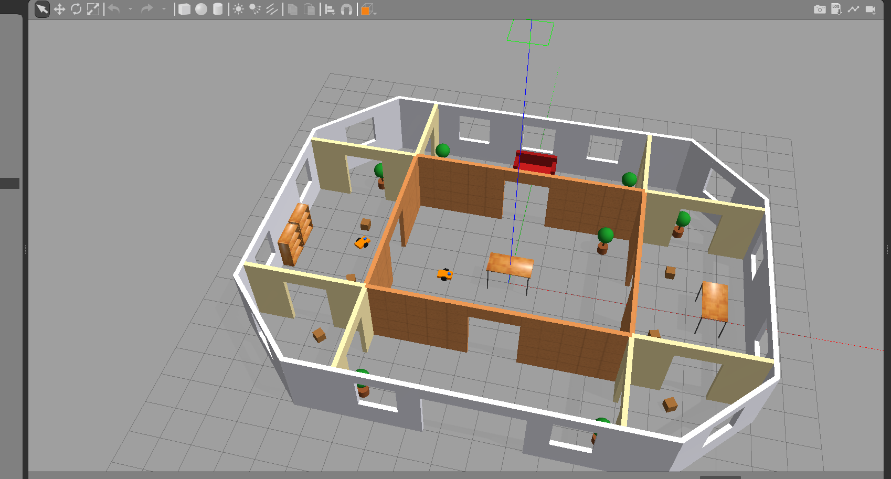
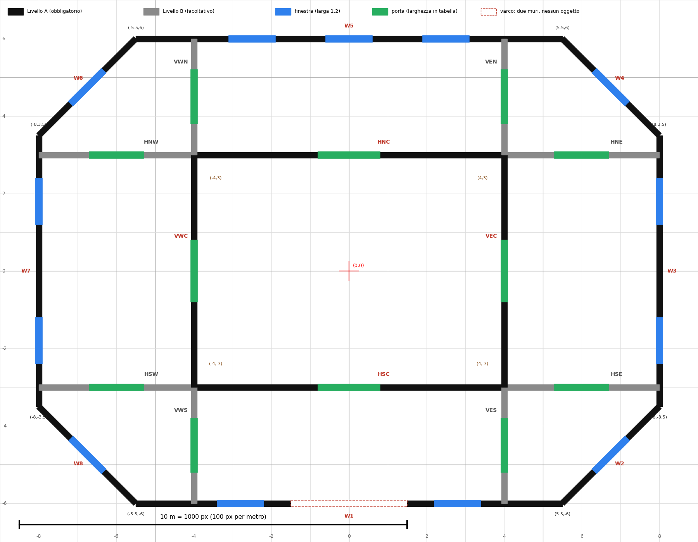

# 01 - Build My World

A Gazebo world with a single-floor building, furniture, two wheeled robots and a C++ world plugin that prints a welcome message when the world starts. This building is the test bench reused by the next four projects.



## What is in the world

| Element | Details |
|---|---|
| Building | Octagonal shell about 16 x 12 m, walls 2.5 m high and 0.15 m thick, a central atrium and a grid of 3 x 3 rooms with doors (1.6 m) and windows (1.2 m) |
| Furniture | 2 tables, 1 sofa, 2 bookshelves, 6 crates, 8 plants |
| Robots | 2 instances of a wheeled rover model |
| Plugin | `welcome_message` (C++ `WorldPlugin`): prints `Welcome to Alessio's World!` as soon as the world loads |
| Total | 23 models in one self-contained world file (5473 lines, no `GAZEBO_MODEL_PATH` needed) |



*Floor plan of the building: coordinates in meters, 100 px per meter, origin at the red cross.*

## Repository layout

```
01-build-my-world/
├── project/            the Gazebo project to run
│   ├── world/MyWorld.world
│   ├── model/          Building, Rover, Table, Bookshelf, Sofa, Crate, Plant
│   ├── script/welcome_message.cpp
│   ├── CMakeLists.txt
│   └── run.sh          builds the plugin and starts Gazebo in one command
├── tools/              the Python scripts that generated and checked the building
└── guide/              step-by-step guide (Italian) to redo the building with the Gazebo Building Editor
```

## Run it

You need Gazebo 11 (classic) and CMake. See [`docs/installation.md`](../docs/installation.md).

```bash
cd 01-build-my-world/project
mkdir build && cd build
cmake .. && make
export GAZEBO_PLUGIN_PATH=$GAZEBO_PLUGIN_PATH:$PWD
cd ../world
gazebo MyWorld.world --verbose
```

The terminal prints the welcome message. `./run.sh` does the same steps in one command.

## How it was made

- The building is **generated by a script** (`tools/gen_building3.py`): an octagonal shell and an orthogonal 3 x 3 room grid built from plain wall boxes with exact junctions (mitred shell corners, interior walls that stop on the face of the wall they meet, no columns), with openings for doors and windows. A script makes the geometry exact and repeatable. It is not drawn by hand in the Gazebo Building Editor.
- To redo the building by hand, `guide/GUIDA_EDITOR.md` lists every wall with its coordinates and `images/floor-plan.png` can be imported in the editor as a tracing image.
- `tools/check_layout.py` and `tools/overlap_check.py` check the geometry of the generated world (layout and overlapping volumes); `tools/sdf_names.py` checks that names are unique inside every SDF model (a rule of Gazebo 11); `tools/normalize.py`, `xmlfmt.py` and `indent_check.py` keep the XML formatting consistent.
- The Bookshelf and Table models come from the Gazebo model library (Apache 2.0); their `model.config` keeps the original author.

## What I learned

- **SDF structure**: a world is a tree of models, links, visuals and collisions with poses; a model can be referenced or written inline, and a self-contained world is easier to move between machines.
- **Models and materials**: `model.config` and `model.sdf`, textures, and how a Gazebo model path is resolved. A stale model in `~/.gazebo/models` can shadow the one of the project.
- **World plugins in C++**: a class derived from `gazebo::WorldPlugin`, registered with `GZ_REGISTER_WORLD_PLUGIN`, compiled to a shared library with CMake and found through `GAZEBO_PLUGIN_PATH`.
- **Designing a world for robots**: walls and corners give a lidar something to see, doors give navigation something to solve, and different textures give a camera something to match. The same building later supported localization, SLAM with RTAB-Map and a home service task.
- **Generate and check instead of hand-placing**: a generator plus geometry, overlap and naming checks catch mistakes that are hard to see in a 3D window.

## Next project

[02 - Go Chase It](../02-go-chase-it/README.md) puts a robot with a camera in this building.
