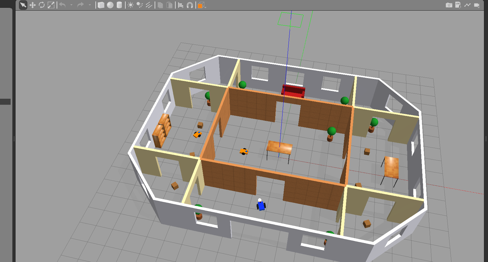
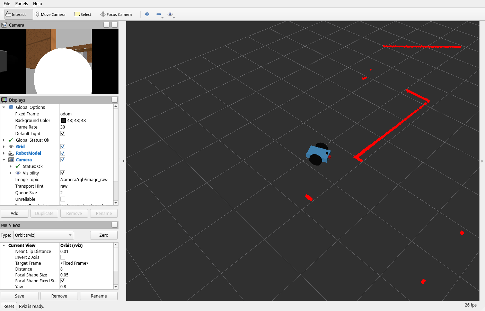

# 02 - Go Chase It

A differential-drive robot with a camera and a lidar, in the building of project 01. Two ROS nodes make it **see a ball with its camera and drive towards it**: an image-processing node finds the ball and asks a drive node, through a ROS service, to turn left, go forward or turn right.

| Gazebo | RViz (robot camera) |
|---|---|
|  |  |

## How it works

```
 Gazebo camera ──► /camera/rgb/image_raw ──► process_image ──(service)──► drive_bot ──► /cmd_vel ──► diff-drive plugin
                                              finds the ball              /ball_chaser/command_robot
```

| Part | What it does |
|---|---|
| `my_robot` | URDF/xacro robot (`robot_footprint`, `chassis`, two wheels, `camera`, `hokuyo`), the world `MyWorld.world` of project 01 with a white ball, RViz configuration, the launch files |
| `ball_chaser/drive_bot` | **Service server** `/ball_chaser/command_robot` (`DriveToTarget.srv`: `linear_x`, `angular_z`, answers with a feedback string). It publishes the velocities on `/cmd_vel` |
| `ball_chaser/process_image` | **Subscriber** of `/camera/rgb/image_raw` and **client** of the service. It finds the ball, splits the image into three vertical bands and sends: ball on the left, turn left; in the middle, drive forward; on the right, turn right; no ball, stop |

### The robot

Chassis 0.5 x 0.3 x 0.12 m, two wheels of 0.15 m radius (wheel separation 0.42 m) driven by the `libgazebo_ros_diff_drive` plugin, a camera (`libgazebo_ros_camera`, 800 x 800 pixels, 80 degrees of field of view) and a Hokuyo-style lidar (`libgazebo_ros_laser`, 720 beams over 180 degrees at 40 Hz, topic `/scan`).

### Finding the ball without OpenCV

The node reads the raw pixel buffer of `sensor_msgs/Image` (3 bytes per pixel) and has two modes (parameter `target_color`):

- **`white`**: the mean column of the pure white pixels (R = G = B = 255).
- **`any`** (default): a small detector that tells a ball from a plant or a wall patch. The image is sampled on a coarse grid and neighbouring samples of similar color are grouped into regions (flood fill): a shaded sphere stays in one region, its edge against the background splits it. A region is accepted as a ball if it has the size, shape (a disc: every row has the width of a disc), color and **floor contact** of one. For a ball resting on the floor and a level camera, the lowest point of the ball is below the horizon by `camera_height / ball_diameter` times its apparent diameter at any distance, and that ratio rejects round objects that are not on the floor.

Colors chased in `any` mode: white, red, green, blue, cyan, purple, magenta. Disabled on purpose: black and dark colors, grey, orange, brown and yellow, because they look like parts of the world (floor, walls, furniture, other robots) and made the robot chase things that are not balls.

In the verification runs the robot chased balls of nine colors and gave no false detection on the plants, walls and furniture of the building.

## Run it

Needs ROS Noetic and Gazebo 11 ([installation guide](../docs/installation.md)).

```bash
cd 02-go-chase-it/catkin_ws
catkin_make
source devel/setup.bash

# terminal 1: Gazebo, RViz, the robot and a white ball in front of it
roslaunch my_robot world.launch

# terminal 2 (source the workspace again): the two ball_chaser nodes
roslaunch ball_chaser ball_chaser.launch
```

The robot drives to the white ball by itself. Put the ball somewhere else with the Gazebo move tool and it turns and follows.

To test another color, edit the model `my_ball` in `my_robot/world/MyWorld.world`: set the four color lines (`ambient`, `diffuse`, `specular`, `emissive`) to the same value, for example `1 0 0 1` for red, and restart `world.launch`. To chase only pure white, set `target_color` to `white` in `ball_chaser.launch`.

## What I learned

- **ROS services**: defining a `.srv`, advertising it with `advertiseService` and calling it with `serviceClient` from another node, and why a service (request and answer) fits "set the velocities" better than a topic.
- **Publishers and subscribers**: the `/cmd_vel` command chain, the camera topic and its message layout (`step`, `encoding`, row-major bytes).
- **Perception from scratch**: reading raw image bytes, flood fill, region features (size, fill ratio, aspect, color) and a geometric floor-contact test. A simple rule ("white pixels") works in a lab; a world with plants, walls and balls of several colors needs a more careful rule.
- **URDF/xacro with Gazebo plugins**: links, joints, inertia and collision, wheel and sensor plugins, the camera frame, and how `robot_state_publisher` turns the description into tf.
- **Launch files and packages**: `catkin` packages with C++ nodes, messages and services (`add_service_files`, `generate_messages`), and launch files that start nodes with parameters.
- **Testing the behavior, not only the build**: the detector was checked against false positives on every object type of the world and against balls of many colors.

## Next project

[03 - Where Am I](../03-where-am-i/README.md) keeps the same robot and teaches it where it is.
