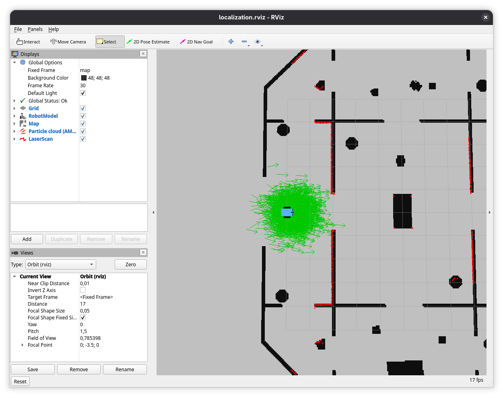
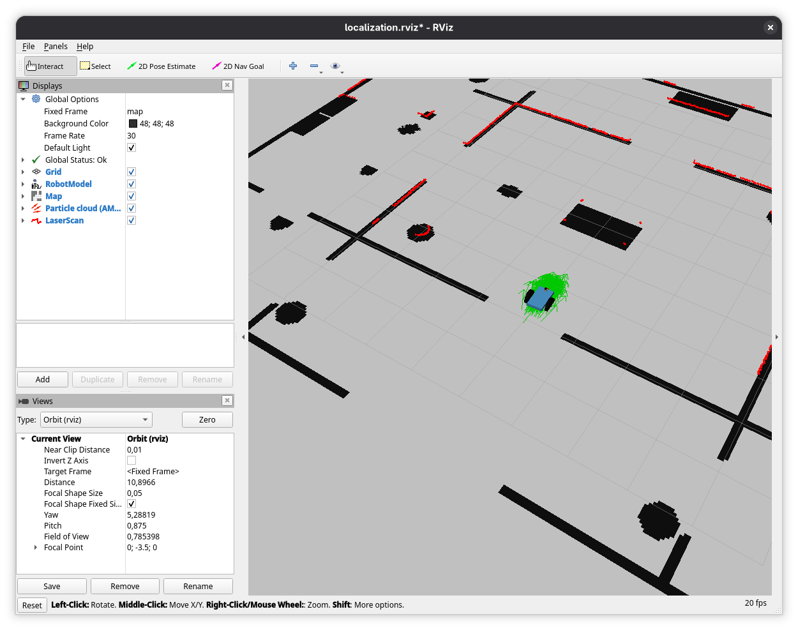

# 03 - Where Am I

The robot of project 02 **localizes itself on a known map** with AMCL (adaptive Monte Carlo localization) and **navigates to goals** with `move_base`, in the building of project 01. ROS Noetic and Gazebo 11.

| Uncertain pose: particles spread around the robot | Moving: the cloud shrinks and follows |
|---|---|
|  |  |

*RViz: the map (black), the laser scan (red), the AMCL particle cloud (green) and the robot model.*

## How it works

```
 /scan (lidar) ─┐
 /odom ─────────┼─► amcl ──► map → odom (tf) ─┐
 map_server ─/map┘                             ├─► move_base ──► /cmd_vel
 2D Nav Goal ──► /move_base_simple/goal ───────┘   navfn (global path) + local planner + costmaps
```

| Node | Role |
|---|---|
| `map_server` | Publishes the saved map (`maps/whereiam.pgm` and `.yaml`, 0.05 m per pixel) on `/map` |
| `amcl` | Particle filter: compares the laser scan with the map and the odometry and publishes the `map -> odom` transform and `/amcl_pose`. 100 to 2000 particles, likelihood-field laser model, diff-corrected odometry model |
| `move_base` | Global planner `navfn` (Dijkstra), local planner `base_local_planner/TrajectoryPlannerROS`, a static global costmap and a rolling local costmap |
| `rviz` | Map, laser, robot model and particle cloud; the tools *2D Pose Estimate* and *2D Nav Goal* |

Frames: `map -> odom -> robot_footprint -> chassis -> camera, hokuyo`.

### Parameters (`config/`)

| File | Main values |
|---|---|
| `amcl_params.yaml` | `odom_model_type: diff-corrected`, `min_particles: 100`, `max_particles: 2000`, `update_min_d/a: 0.1`, `laser_model_type: likelihood_field`, `laser_max_beams: 60`, initial pose = the spawn pose (0, -5, 1.5708) |
| `costmap_common_params.yaml` | `obstacle_range: 1.0`, `raytrace_range: 2.0`, `robot_radius: 0.3`, `inflation_radius: 0.5`, `cost_scaling_factor: 5.0`, laser as the obstacle source |
| `global_costmap_params.yaml` / `local_costmap_params.yaml` | global: static map, 20 x 20 m, 2 Hz; local: rolling window 10 x 10 m, 5 Hz |
| `base_local_planner_params.yaml` | `max_vel_x: 1.0`, `max_vel_theta: 1.57`, `sim_time: 1.0`, `pdist_scale: 0.6`, `gdist_scale: 0.8`, `occdist_scale: 0.02` |

## Run it

Needs ROS Noetic, Gazebo 11 and the `navigation` stack ([installation guide](../docs/installation.md)). The keyboard teleoperation node is included in the workspace.

```bash
cd 03-where-am-i/catkin_ws
catkin_make -DCATKIN_ENABLE_TESTING=0
source devel/setup.bash

roslaunch my_robot world.launch rviz:=false              # terminal 1: Gazebo, world and robot
roslaunch my_robot localization.launch                   # terminal 2: map_server, amcl, move_base, RViz
rosrun teleop_twist_keyboard teleop_twist_keyboard.py    # terminal 3: drive with the keyboard
```

(`source devel/setup.bash` in every terminal.) In RViz use *2D Pose Estimate* to give AMCL an initial pose and *2D Nav Goal* to send a goal. Drive the robot a few meters and watch the particle cloud collapse around it.

## Results and limits

- With a known initial pose AMCL tracks the robot with errors of about 0.01 to 0.2 m.
- The floor plan is nearly symmetric, so **global localization** (`/global_localization`, particles spread over the whole map) does **not** converge: several poses explain the same scan. A good initial pose is part of the setup.
- **The map shows the doors as closed.** The map was made with `pgm_map_creator`, which casts rays from above: the rays hit the wall segment over each door opening (the lintel), so the openings look like walls, although a lidar at robot height sees through them. AMCL is not affected, but a global path can not go through a "closed" door. Project 05 avoids this by building the map with SLAM (gmapping) from the lidar itself, and its [tuning notes](../docs/navigation-and-slam-tuning.md) show the planner and costmap values that made door crossing reliable.
- The parameters above are the ones of the delivered version. In the tuning done later for project 05 (DWA planner, footprint instead of a radius, longer obstacle range) the robot stopped turning on itself and crossed doors reliably.

## What I learned

- **Monte Carlo localization**: particles are hypotheses of the pose; the motion model spreads them, the laser likelihood weights them, resampling concentrates them. The initial pose, the number of particles and the update thresholds decide how fast and how well it converges.
- **The map and tf**: AMCL does not publish the robot pose directly but the `map -> odom` correction, so the pose in the map is `map -> odom -> base`.
- **Why a symmetric world is hard to localize in**: a nearly symmetric plan makes several places look the same, so the filter needs a good prior.
- **The navigation stack**: global planner, local planner and two costmaps, and what each parameter does (`robot_radius`, `inflation_radius`, `cost_scaling_factor`, the range of the obstacle layer, the planner speed limits and scoring weights).
- **Costmaps**: inflation turns obstacles into costs that keep the path away from walls; with a door of 1.5 m a radius plus an inflation that are too large close the door for the planner.
- **Where a map comes from matters**: a map generated from the world geometry and a map recorded by SLAM differ in details that the planner is sensitive to.

## Next project

[04 - Map My World](../04-map-my-world/README.md) builds the map instead of receiving it, with RTAB-Map and an RGB-D camera.
