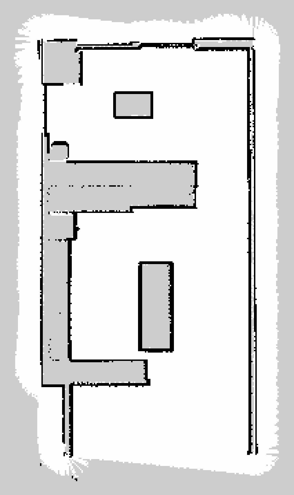
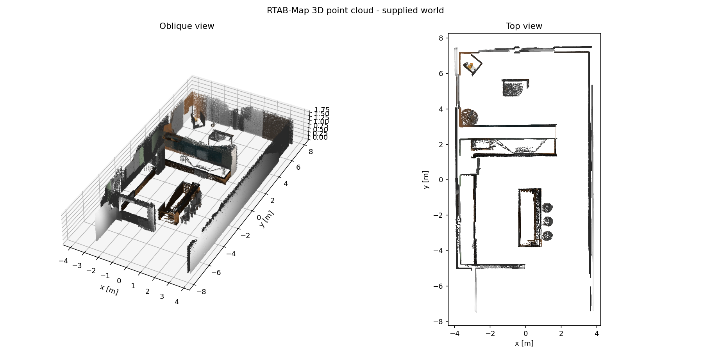
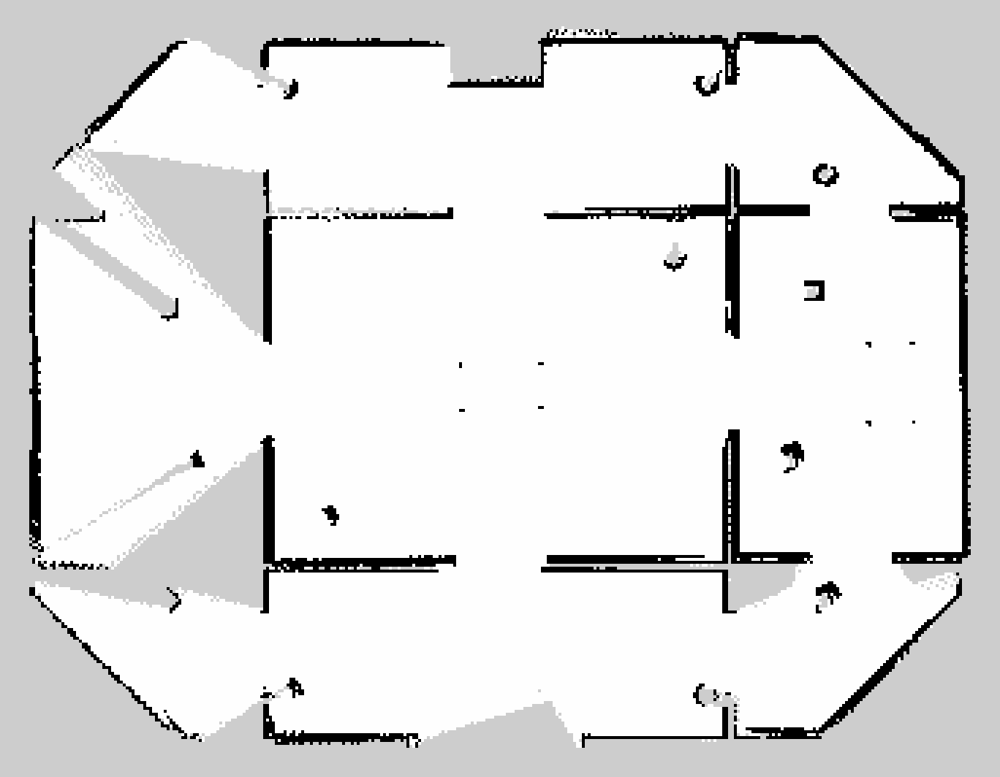
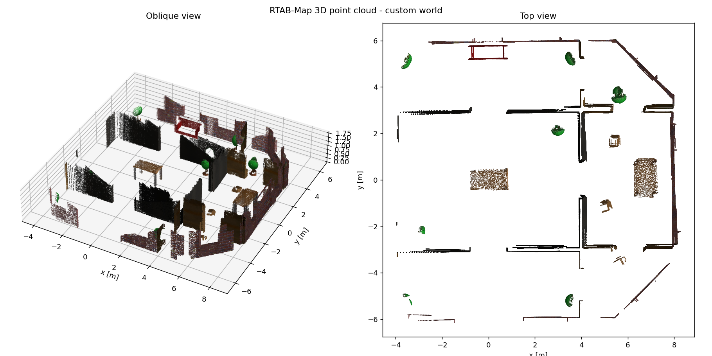
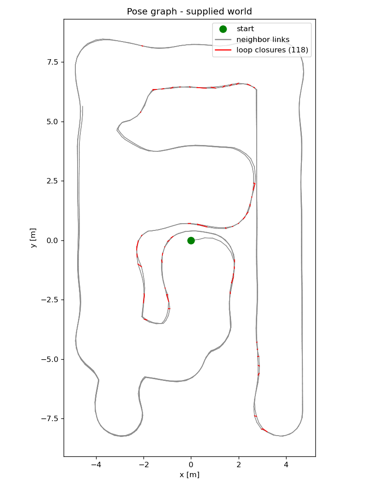
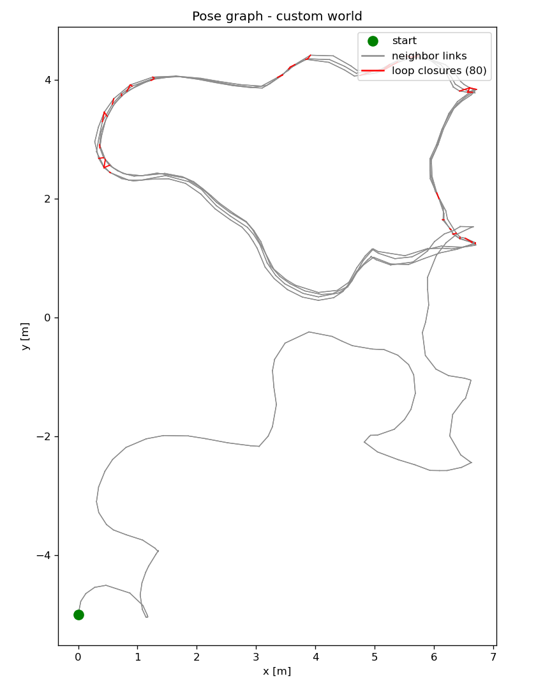
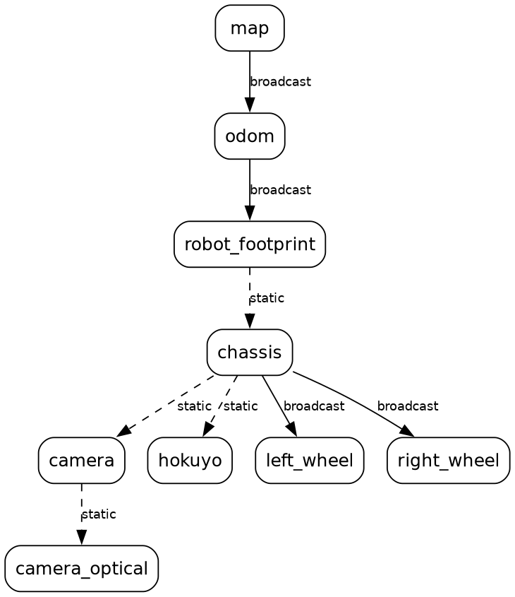

# 04 - Map My World

**Appearance-based SLAM with RTAB-Map** on a robot with a lidar and an **RGB-D camera**, in Gazebo. The robot drives through a world, RTAB-Map builds a graph of places with loop closures, and the result is a **2D occupancy grid**, a **3D point cloud** and a database that can be used to **localize** later. Two worlds were mapped: a kitchen and dining room, and the building of project 01.

| 2D occupancy grid (kitchen) | 3D point cloud (kitchen) |
|---|---|
|  |  |

| 2D occupancy grid (custom building) | 3D point cloud (custom building) |
|---|---|
|  |  |

## Results

| | Kitchen and dining room | Custom building (project 01) |
|---|---|---|
| Graph nodes | 770 | 403 |
| Distance driven | 230 m | 87 m |
| Global loop closures | **118** (the goal was at least 3) | **80** |
| Loop closures consistent with the odometry (within 0.3 m and 10 degrees) | 115 of 118, median error 0.037 m | 80 of 80, median error 0.012 m |
| Pose graph |  |  |

- **Localization** with the kitchen database (RTAB-Map in localization mode, the database is not modified): the error against the pose of Gazebo stayed between 0.03 and 0.42 m over a 100 s run and was 0.05 m at the end.
- **Stable simulation**: the robot does not move or drift without commands (0.0000 m in 30 s) and Gazebo runs at 1.00x real time (kitchen) and 0.97x (custom) before mapping, about 0.9x while mapping.
- The full write-up with figures is in [`report/map_my_world_report.pdf`](report/map_my_world_report.pdf).
- The RTAB-Map databases (86 MB and 82 MB) are **not in this repository** because of their size; see [Recreate the databases](#recreate-the-databases).

### The tf tree



`map -> odom` (RTAB-Map) `-> robot_footprint` (odometry) `-> chassis -> camera -> camera_optical`, `hokuyo`, wheels.

## The package `my_robot`

| Part | Content |
|---|---|
| `launch/world.launch` | Gazebo world (`world:=custom_world.world` for the building), robot spawn pose, RViz |
| `launch/mapping.launch` | RTAB-Map in mapping mode (`--delete_db_on_start`), remaps of the scan, RGB, depth and camera info topics, grid map on `/map` |
| `launch/localization.launch` | The same node with `Mem/IncrementalMemory false` and `RGBD/StartAtOrigin true` |
| `launch/teleop.launch` | Keyboard teleoperation in an `xterm`; without `xterm` run `rosrun teleop_twist_keyboard teleop_twist_keyboard.py` |
| `urdf/` | Differential drive, Hokuyo lidar, and an RGB-D camera with `libgazebo_ros_openni_kinect` and the optical frame (`rpy -1.5707 0 -1.5707`) |
| `worlds/`, `models/kitchen_dining` | The kitchen world and the custom building |

### RTAB-Map parameters that mattered

| Parameter | Used | Why |
|---|---|---|
| `Kp/DetectorStrategy` | 1 (SIFT) | SURF is not in the OpenCV of conda-forge |
| `Kp/MaxFeatures` | 1000 | the template has 400 |
| `Vis/MinInliers`, `Rtabmap/LoopThr` | 8 and 0.05 (kitchen), 20 and 0.11 (custom) | with the template values the kitchen gave zero loop closures; the repeating textures of the building gave wrong ones |
| `RGBD/OptimizeMaxError` | 1.0 (optional) | rejects loop closures that make the graph worse |
| `Reg/Force3DoF` | true | planar robot |
| `Rtabmap/DetectionRate` | 1 | one node per second, enough at 0.3 m/s |

More in [`docs/navigation-and-slam-tuning.md`](../docs/navigation-and-slam-tuning.md).

## Run it

Needs ROS Noetic, Gazebo 11, `rtabmap_ros`, `teleop_twist_keyboard` and `gazebo_ros_pkgs` ([installation guide](../docs/installation.md)).

```bash
cd 04-map-my-world/catkin_ws
catkin_make
source devel/setup.bash

roslaunch my_robot world.launch                      # terminal 1
roslaunch my_robot mapping.launch                    # terminal 2
roslaunch my_robot teleop.launch                     # terminal 3 (needs xterm): drive slowly, revisit places
```

- With `rtabmap_ros` 0.21 or newer add `slam_pkg:=rtabmap_slam` to `mapping.launch` and `localization.launch`.
- The database is written to `~/.ros/rtabmap.db` when `mapping.launch` stops with Ctrl+C. Mapping deletes the previous database at start: copy it first.
- Custom building: `roslaunch my_robot world.launch world:=custom_world.world y:=-5 yaw:=1.5708`, and `loop_thr:=0.11 min_inliers:=20` on `mapping.launch`.
- Localization: `roslaunch my_robot localization.launch database_path:=<path>/rtabmap.db`, with the robot at the pose where the mapping started.
- Look inside a database: `rtabmap-databaseViewer rtabmap.db`.

### Recreate the databases

Drive the robot slowly (about 0.3 m/s) around the world for 10 to 15 minutes, passing through the same places two or three times, then stop `mapping.launch` with Ctrl+C. The databases of this project were recorded with an automatic wall follower (the same idea as `05-home-service-robot/scripts/explore_walls.py`) instead of the keyboard.

Helper scripts in `tools/` (they need `numpy`, `matplotlib`, `sqlite3`; the cloud export uses `rtabmap-export`):

| Script | What it does |
|---|---|
| `badloops.py <db>` | counts the loop closures that disagree with the odometry by more than 0.3 m or 10 degrees |
| `loops.py <db> <png> <title>` | plots the optimized pose graph with the loop closures |
| `render3d.py <ply> <png> <title>` | renders the cloud exported with `rtabmap-export --cloud --decimation 1 --voxel 0.02 --max_depth 5` |
| `gen_coll.py <dae> <xml>` | turns the mesh of the kitchen into box collision shapes (see below) |

## What I learned

- **How RTAB-Map works**: a short-term and a long-term memory, a bag-of-words loop closure detector on visual features, a graph optimizer (nodes are poses, links are odometry and loop closures), and an occupancy grid assembled from the optimized poses.
- **Launch files as a system**: remapped topics, frame ids and parameters that must agree across `rtabmap`, the camera plugin and the URDF; the optical frame of the camera is not the camera link.
- **Features decide everything**: too few features and nothing closes; repeating textures and a symmetric building close the wrong places. Slow motion and revisiting places matter more than any single parameter.
- **Never trust a loop closure without a check**: comparing every closure with the odometry found the few wrong ones that bent the map, and one parameter (`RGBD/OptimizeMaxError`) removed them.
- **Reprocess instead of resimulating**: `rtabmap-reprocess` tries other parameters on a recorded database in about 30 s.
- **Exporting a good 3D map**: the default decimation of `rtabmap-export` reduces the depth image by 4; exporting at full resolution with a voxel filter gave a dense, readable cloud.
- **Simulation cost**: camera resolution and mesh complexity decide the real-time factor; the camera was lowered to 320 x 240 at 3 Hz.

## Next project

[05 - Home Service Robot](../05-home-service-robot/README.md) uses SLAM, localization and navigation together to carry an object.
