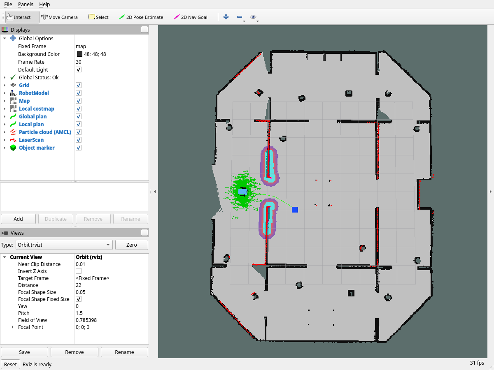
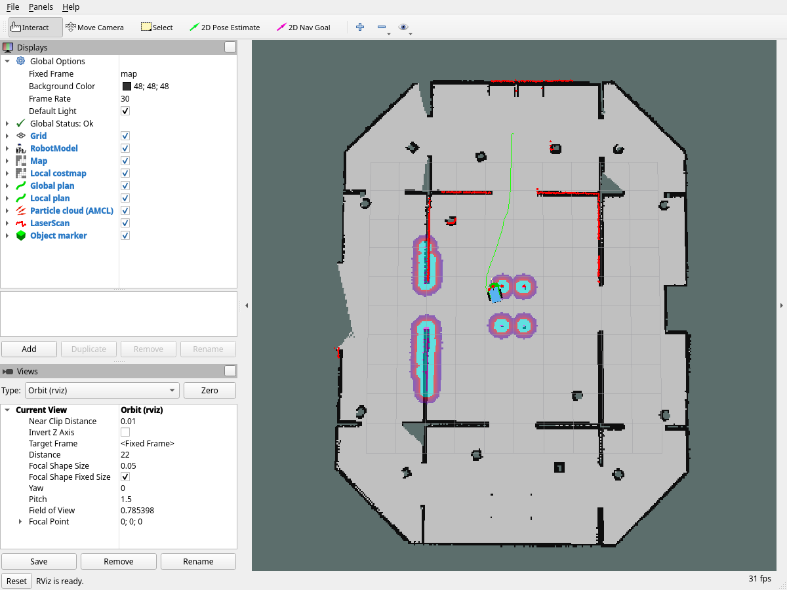
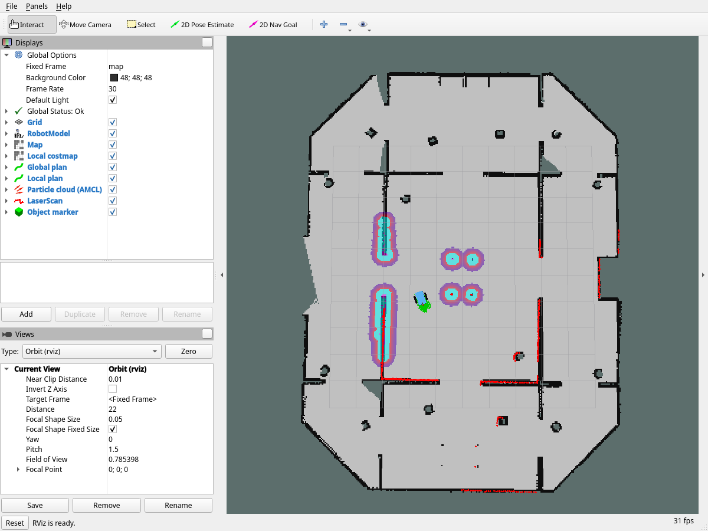
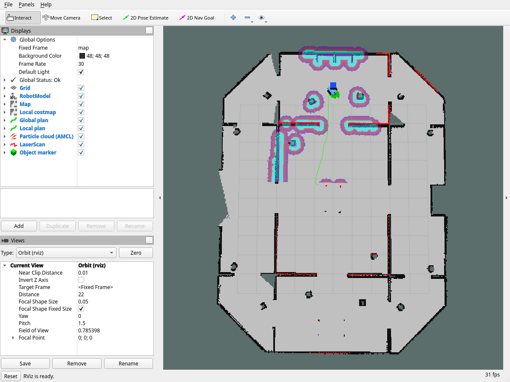

# 05 - Home Service Robot

The capstone: a robot that **maps a building with SLAM, localizes itself, navigates, picks up a virtual object at a pickup zone and delivers it to a drop-off zone**. The object is a cube marker in RViz. It brings together the world of project 01, the robot of projects 02 and 03, the localization and navigation of project 03, and the SLAM experience of project 04.

| Start: marker at the pickup zone | Carrying: marker hidden |
|---|---|
|  |  |

| Navigation: global path (green), costmap and particles | End: marker at the drop-off zone |
|---|---|
|  |  |

## What it does

```
 Gazebo ── /scan, /odom ──► gmapping ──► map ──► map_saver ──► maps/home_service.pgm
                                                                       │
 Gazebo ── /scan, /odom ──► amcl (map → odom) ◄──── map_server ◄───────┘
                              │
 pick_objects ──goal──► move_base (navfn + DWA, costmaps) ──► /cmd_vel ──► robot
      │ pickup, wait 5 s, drop-off
      ▼
 add_markers ◄── /amcl_pose ── shows the cube at the pickup zone, hides it when the robot arrives,
                               shows it at the drop-off zone when the robot arrives there
```

### Scripts (`scripts/`)

| Script | What it does |
|---|---|
| `test_slam.sh` | Gazebo with the robot, **gmapping**, RViz and keyboard teleoperation (`./test_slam.sh rtabmap` uses RTAB-Map instead) |
| `test_navigation.sh` | Gazebo, map server, AMCL, `move_base` and RViz: send goals with the *2D Nav Goal* tool |
| `pick_objects.sh` | Navigation plus the goal node: pickup zone, "Reached the pickup zone", 5 seconds wait, drop-off zone, "Reached the drop-off zone: object delivered" |
| `add_marker.sh` | Marker test: pickup zone, hidden after 5 s, drop-off zone after other 5 s. `./add_marker.sh robot` makes the marker follow the robot instead |
| `home_service.sh` | **The whole task**: everything above, in the right order |
| `explore_walls.py` | Drives the robot along the walls so a map can be recorded without the keyboard |

Each script starts `roscore`, Gazebo and the nodes it needs, in order, **waiting until each part is ready** (`/gazebo/get_world_properties`, `/scan`, `/odom`, `/move_base/status`) instead of using fixed sleeps. With `xterm` installed every node opens in its own window; without it the nodes run in the background with their logs in `/tmp/home_service_logs`, and the teleoperation runs in the current terminal. `HEADLESS=1 ./home_service.sh` runs everything without windows. A trap stops every process when the script ends.

### Packages (`catkin_ws/src/`)

| Package | Content |
|---|---|
| `my_robot` | URDF/xacro robot (differential drive, lidar, RGB-D camera), the world `home_service.world` (the building of project 01), the saved map, all the configuration (`amcl`, `gmapping`, costmaps, DWA, zones), RViz files and the launch files (`world`, `mapping`, `amcl`, `move_base`, `navigation`, `mapping_rtabmap`) |
| `pick_objects` | C++ node: a `SimpleActionClient` of `move_base`. It sends the pickup goal and the drop-off goal in the `map` frame, prints a message at each step and waits 5 seconds at the pickup zone |
| `add_markers` | C++ node that publishes a cube on `/visualization_marker` (latched, so a late RViz still sees it). Mode `pose`: follows `/amcl_pose`. Mode `timed`: the fixed sequence of the marker test |

The pickup zone (1.0, -1.5), the drop-off zone (-6.0, 0.0), the arrival tolerance (0.3 m) and the wait (5 s) are in **one file**, `my_robot/config/zones.yaml`, read by both nodes.

### ROS packages used

`gmapping` (SLAM), `map_server`, `amcl` (localization), `move_base` with `navfn` and `dwa_local_planner` (navigation), `teleop_twist_keyboard`, `robot_state_publisher`, `joint_state_publisher`, `gazebo_ros`, `rviz`, `visualization_msgs`, `actionlib`, and optionally `rtabmap_ros`. The robot is the one of the previous projects, not the TurtleBot, so the TurtleBot packages are not needed.

## Results

| Test | Result |
|---|---|
| Map | 480 x 480 cells of 5 cm made with gmapping while the robot followed the walls for 8 minutes: walls, door openings and furniture match the world |
| Navigation with goals like the *2D Nav Goal* tool | 4 goals in different rooms reached in 15 to 30 s each |
| `add_marker.sh` | marker at the pickup zone at 0.4 s, hidden at 5.4 s, at the drop-off zone at 10.4 s |
| `add_marker.sh robot` | marker at the pickup zone at the start, hidden when the robot arrives, shown at the drop-off zone when it arrives there |
| `home_service.sh` (final configuration) | **6 out of 6** complete runs delivered (3 from the working folder and 3 from the extracted archive); the pickup is reached about 12 s after the goal, the drop-off 25 to 35 s after the 5 s wait; path 11.1 to 11.6 m |
| Keyboard teleoperation | the robot moved 9.9 m and the map grew from 18311 to 53198 known cells (keys fed through a virtual terminal) |

## From a robot that turns on itself to one that drives to the goal

The first version used the default local planner and worked, but badly: it **turned on itself for long times**, changed direction near the table and stopped in door openings. Instead of guessing parameters, the behavior was measured on a fixed scenario (spawn, pickup, drop-off, about 12 m) with `tools/navigation_metrics.py`:

| Measure | `TrajectoryPlannerROS` (first version) | `DWAPlannerROS` (final) |
|---|---|---|
| Full turns of the robot on itself | 2.8 to 7.6 | **1.2 to 2.3** |
| Time below 0.05 m/s | 39 to 70 s | 18 to 36 s (including the 5 s wait) |
| Arrival at the drop-off (simulated seconds from the start) | 77 to 120 | **61 to 71** |
| Crossing the building to a goal 12 m away | 60 to 175 s | **15 to 30 s** |
| Global plans per run | 4 (the global path was already right) | 4 to 12 |

What changed, in order of impact:

1. **Local planner**: `DWAPlannerROS` instead of `TrajectoryPlannerROS`.
2. **Costmap ranges**: obstacles marked up to 2.5 m instead of 1.0 m, so door frames are seen in time.
3. **Footprint**: the real rectangle (0.5 x 0.48 m, wheels included) instead of a circle of 0.3 m, which had stopped the robot in a 1.5 m door in 2 of 6 runs.
4. **Lidar**: field of view of 200 degrees. At 360 degrees the lidar saw the wheels of the robot as obstacles (172 beams closer than 0.45 m) and `move_base` failed every goal; raising it above the wheels made the 0.3 m high crates invisible.
5. **AMCL**: small odometry noise, since the odometry of the simulation is exact.

The numbers and values are in [`docs/navigation-and-slam-tuning.md`](../docs/navigation-and-slam-tuning.md); each problem and fix is in [`docs/troubleshooting.md`](../docs/troubleshooting.md).

## Run it

Needs ROS Noetic with `gazebo_ros_pkgs`, `gmapping`, `amcl`, `map_server`, `move_base`, `dwa_local_planner`, `navfn`, `teleop_twist_keyboard`, `rviz`, `xacro`, and optionally `xterm` ([installation guide](../docs/installation.md)).

```bash
cd 05-home-service-robot/catkin_ws
catkin_make
source devel/setup.bash
cd ../scripts

./test_slam.sh          # 1. map the building (drive with the keyboard), then save the map:
                        #    rosrun map_server map_saver -f $(rospack find my_robot)/maps/home_service
./test_navigation.sh    # 2. send goals with 2D Nav Goal
./pick_objects.sh       # 3. pickup and drop-off without the marker
./add_marker.sh         # 4. marker test
./home_service.sh       # 5. everything
```

The repository already contains a saved map, so you can start from step 2. Press Ctrl+C in the terminal of the script to stop everything.

### Measuring the navigation

```bash
python3 tools/navigation_metrics.py     # run it while the robot moves; stop it with Ctrl+C
# METRICS path 11.4 m | total rotation 2.3 turns | time below 0.05 m/s 18 s | global plans 6
```

## What I learned

- **Putting a system together**: five packages and four ROS stacks (Gazebo, gmapping, AMCL, `move_base`) work only if frames, topics, the clock and start-up order agree. Scripts that wait for readiness instead of sleeping made the whole task reproducible.
- **Navigation is tuning, and tuning needs numbers**: a fixed scenario, repeated runs and three simple measures (rotation, time below a speed, path length) turned "it looks bad" into a comparison between planners.
- **Sensors have geometry**: the field of view and the height of the lidar decided what the costmaps knew; reading one scan with the robot still found the wheels in the lidar's view.
- **Footprint, inflation and doors**: a circle larger than the robot and an inflation larger than half a door close the door for the planner.
- **A small state machine across two nodes**: the goal node drives, the marker node watches the pose; one shared YAML file for the zones prevents the two from disagreeing.
- **SLAM and localization are one pipeline**: the map made by gmapping is the map AMCL and the global costmap use, in the same coordinates as the world.
- **Honest verification**: building and running the delivered archive in a clean folder, not a development copy, found problems that the development copy hid.
