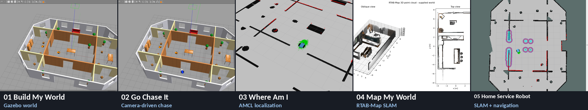

# Udacity Robotic Software Engineer

**Five ROS and Gazebo projects that take a mobile robot from an empty simulation to a complete home service task: world building, camera-based control, localization with AMCL, SLAM with RTAB-Map and gmapping, and autonomous navigation with `move_base`.**




This repository collects the five projects of the **Udacity Robotics Software Engineer** program, each one built on the previous one: the same building, the same differential-drive robot, and a growing set of ROS skills. Every project has a README with the design, the results, the screenshots, how to run it and what was learned; there are also guides to install ROS Noetic and Gazebo and to try everything on your own computer.

## Contents

- [The five projects](#the-five-projects)
- [Highlights](#highlights)
- [Skills and tools](#skills-and-tools)
- [Try it on your computer](#try-it-on-your-computer)
- [Repository structure](#repository-structure)
- [Documentation](#documentation)
- [Third-party material and licenses](#third-party-material-and-licenses)

## The five projects

| # | Project | What it is | Main ideas | Result |
|---|---|---|---|---|
| 01 | [**Build My World**](01-build-my-world/README.md) | A Gazebo world: an octagonal single-floor building with 3 x 3 rooms, doors and windows, furniture, two robots and a C++ world plugin | SDF models, world plugins, generating and checking geometry | 23 models in one self-contained world, a welcome message from the plugin |
| 02 | [**Go Chase It**](02-go-chase-it/README.md) | A robot with a camera and a lidar that sees a ball and drives to it | ROS services and topics, C++ image processing without OpenCV, URDF with Gazebo plugins | A detector that tells a ball from plants and walls; balls of nine colors chased |
| 03 | [**Where Am I**](03-where-am-i/README.md) | The robot localizes itself on a known map and navigates to goals | AMCL, `map_server`, `move_base`, costmaps | Position error of 0.01 to 0.2 m while tracking; limits of global localization explained |
| 04 | [**Map My World**](04-map-my-world/README.md) | Appearance-based SLAM with an RGB-D camera, in two worlds | RTAB-Map, loop closure, 2D grid and 3D cloud, database localization | 118 and 80 loop closures, checked against the odometry; a 3D map and a report |
| 05 | [**Home Service Robot**](05-home-service-robot/README.md) | The capstone: map, localize, navigate, pick up a virtual object and deliver it | gmapping, AMCL, `move_base` with DWA, goal and marker nodes, shell scripts | 6 out of 6 complete deliveries; from 2.8 to 7.6 turns on itself down to 1.2 to 2.3 |

### 01 - Build My World
A building designed to be a good test bench: clear walls and corners for a lidar, doors for a planner, different textures for a camera. The geometry is generated by a script with exact wall junctions and checked for overlaps. [Read more](01-build-my-world/README.md)

### 02 - Go Chase It
Two ROS nodes: `process_image` reads the camera, groups similar pixels into regions and accepts a region as a ball only if its size, shape, color and floor contact fit; `drive_bot` is a ROS service server that turns the answer (left, forward, right) into `/cmd_vel`. [Read more](02-go-chase-it/README.md)

### 03 - Where Am I
AMCL keeps a cloud of pose hypotheses and weights them with the laser; `move_base` plans with `navfn` and drives with a local planner over two costmaps. The README also explains what did not work (a nearly symmetric plan defeats global localization; a map made from above shows doors as walls). [Read more](03-where-am-i/README.md)

### 04 - Map My World
RTAB-Map builds a pose graph from RGB-D and lidar data and closes loops by appearance. The work includes tuning the parameters until loop closures appear, spotting the wrong ones by comparing them with the exact odometry, and exporting a dense 3D cloud. [Read more](04-map-my-world/README.md)

### 05 - Home Service Robot
Everything together: `test_slam.sh`, `test_navigation.sh`, `pick_objects.sh`, `add_marker.sh` and `home_service.sh` start the nodes in the right order and wait for each part to be ready. The README tells how a robot that spun on itself was measured and fixed (local planner, costmap ranges, footprint, lidar field of view). [Read more](05-home-service-robot/README.md)

## Highlights

- **Measured navigation tuning**: path length, full turns of rotation and time below a speed threshold on a fixed scenario; planner switched from `TrajectoryPlannerROS` to `DWAPlannerROS`; crossing the building to a goal 12 m away went from 60 to 175 s to 15 to 30 s ([details](05-home-service-robot/README.md#from-a-robot-that-turns-on-itself-to-one-that-drives-to-the-goal)).
- **SLAM you can trust**: every RTAB-Map loop closure checked against the odometry; 115 of 118 and 80 of 80 agree within 0.3 m and 10 degrees ([details](04-map-my-world/README.md#results)).
- **Real sensor debugging**: a 360 degree lidar that saw the robot's own wheels, crates invisible to a raised lidar, and the choice of a 200 degree field of view ([troubleshooting](docs/troubleshooting.md)).
- **Reproducible runs**: shell scripts with readiness checks, a headless mode, and the later projects built and run from a clean copy of their archive before delivery.

## Skills and tools

| Area | What is in the repository |
|---|---|
| **ROS 1 (Noetic)** | packages, nodes in C++ and Python, topics, services, action clients, launch files, parameters, `tf` |
| **Gazebo 11** | SDF worlds and models, world plugins, sensor and drive plugins, URDF/xacro |
| **Localization and mapping** | AMCL, gmapping, RTAB-Map (RGB-D, loop closure, database localization), `map_server` |
| **Navigation** | `move_base`, `navfn`, DWA and trajectory-rollout planners, global and local costmaps, footprint and inflation tuning |
| **Perception** | image processing from raw `sensor_msgs/Image`, lidar geometry, depth images and 3D point clouds |
| **Tooling** | RViz, `rtabmap-databaseViewer`, `rtabmap-export`, shell scripting with `xterm`, CMake, catkin |
| **Method** | measure before tuning, ground-truth checks, offline reprocessing, clean-archive verification |

## Try it on your computer

1. Install ROS Noetic and Gazebo 11: [`docs/installation.md`](docs/installation.md) (Ubuntu 20.04 with apt, or RoboStack with micromamba on other Linux).
2. Follow the tour in [`docs/running-the-projects.md`](docs/running-the-projects.md). The quickest rewarding one is the capstone:

```bash
git clone https://github.com/AlePompeo/Udacity-Robotic-Software-Engineer.git
cd Udacity-Robotic-Software-Engineer/05-home-service-robot/catkin_ws
catkin_make && source devel/setup.bash
cd ../scripts && ./home_service.sh
```

The robot drives to the pickup zone, the blue cube disappears, five seconds later the robot drives to the drop-off zone and the cube appears there.

## Repository structure

```
Udacity-Robotic-Software-Engineer/
├── 01-build-my-world/        Gazebo world, models, plugin, generator and check scripts
├── 02-go-chase-it/           catkin_ws with my_robot and ball_chaser
├── 03-where-am-i/            catkin_ws with the AMCL and move_base configuration and the map
├── 04-map-my-world/          catkin_ws with the RTAB-Map launch files, images, report, helper scripts
├── 05-home-service-robot/    catkin_ws, scripts, saved map, images, write-up, measuring tool
└── docs/                     installation, running, lessons learned, troubleshooting, tuning reference
```

Each project folder is self-contained. Build artifacts (`build/`, `devel/`) and the large RTAB-Map databases are not versioned.

## Documentation

| Page | Content |
|---|---|
| [`docs/installation.md`](docs/installation.md) | ROS Noetic and Gazebo 11 on Ubuntu 20.04 (apt) and on other Linux (RoboStack, micromamba) |
| [`docs/running-the-projects.md`](docs/running-the-projects.md) | What to run for every project, how long it takes, what to expect |
| [`docs/lessons-learned.md`](docs/lessons-learned.md) | What repeated across the projects: how the pieces fit, and the working method |
| [`docs/troubleshooting.md`](docs/troubleshooting.md) | Problems met, their cause and the verified fix |
| [`docs/navigation-and-slam-tuning.md`](docs/navigation-and-slam-tuning.md) | The values used for `move_base`, DWA, AMCL, gmapping and RTAB-Map, with the reason for each |

## Third-party material and licenses

- The `Bookshelf` and `Table` models and the `kitchen_dining` mesh come from the Gazebo model library (Open Source Robotics Foundation, Apache 2.0); their `model.config` files keep the original author.
- `03-where-am-i/catkin_ws/src/teleop_twist_keyboard` is the ROS package of the same name (BSD).
- The code and documents written for this repository are released under the MIT License, see [`LICENSE`](LICENSE).

## Author

Built by [AlePompeo](https://github.com/AlePompeo) as part of the Udacity Robotics Software Engineer program.

---

*Keywords: Udacity Robotics Software Engineer Nanodegree, ROS Noetic, Gazebo, SLAM, RTAB-Map, gmapping, AMCL, move_base, autonomous navigation, mobile robot, localization, mapping, differential drive robot, URDF, SDF, RViz, C++ ROS nodes, home service robot.*
